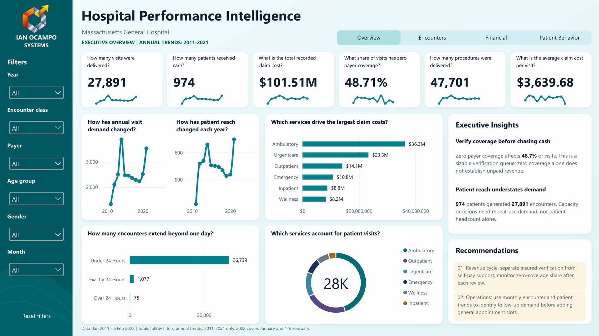
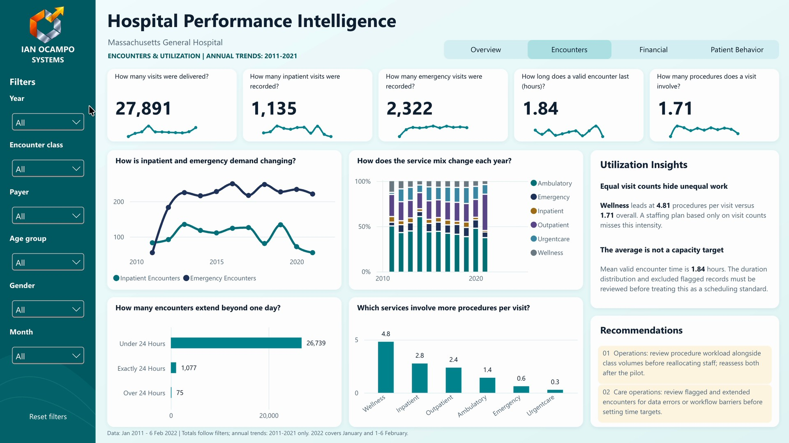
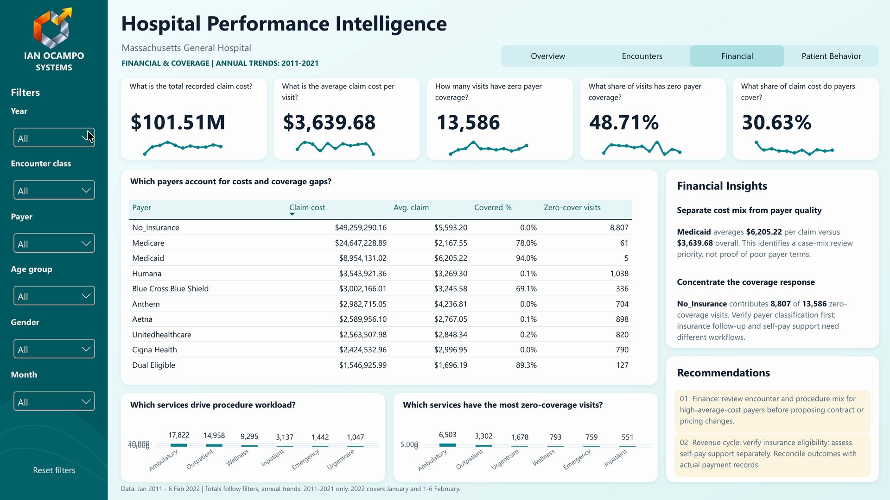
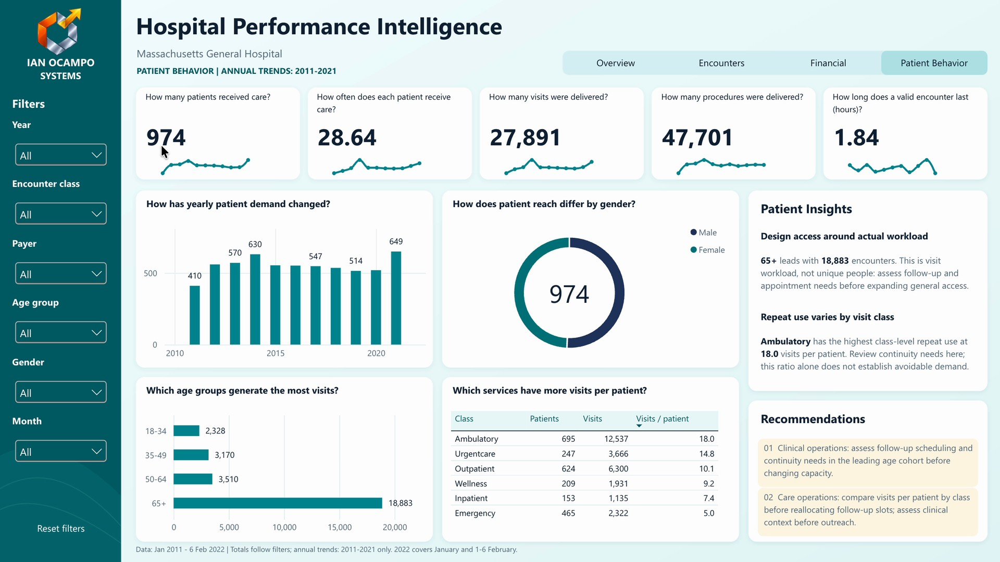

# Hospital Performance Analytics | Power BI

**Connecting patient demand, service workload and payer-coverage patterns to practical management decisions.**

A four-view Microsoft Power BI analytics case study based on **synthetic Hospital Patient Records**. The report explores encounters, procedures, service intensity, payer-coverage patterns and patient behavior without claiming that historical demo observations are real hospital operating outcomes.

**Approved report title:** *Hospital Performance Intelligence*  
**Ian Ocampo** · Business & Digital Systems Integrator · Data Analytics & Business Intelligence  
**Data Portfolio:** [DATA PORT — Data Analytics](https://data.ianocamposystems.com)

[**Download native Power BI project**](powerbi/IanOcampo_PBI_Capstone.pbix) · [**Original dataset (Maven)**](https://mavenanalytics.io/data-playground/hospital-patient-records) · [**Dashboard gallery**](#four-report-views) · [**Executive case study (PDF)**](docs/executive-case-study.pdf) · [**Executive findings**](#what-the-records-show) · [**KPI dictionary**](docs/kpi-definitions.md) · [**Methodology and limitations**](docs/methodology-and-limitations.md)

*Actual 1920×1080 report screenshot from the approved 15-page October 2026 executive case study, captured with filters in the overall All context.*

## The business question

> **Where is hospital workload concentrated, which payer-coverage patterns need investigation, and what patient segments deserve closer operational review?**

The dashboard combines four report views, six recurring filters and a consistent KPI framework so decision-makers can move from an overall signal to a more specific service, payer, year or patient cohort.

## Executive snapshot

| Metric | Approved overall value |
| :--- | ---: |
| Total encounters | **27,891** |
| Unique patients | **974** |
| Linked procedures | **47,701** |
| Recorded total claim cost | **$101.51M** |
| Recorded payer coverage | **$31.10M** |
| Encounters with zero recorded payer coverage | **13,586 / 48.71%** |
| Analysis period | **2 Jan 2011 – 6 Feb 2022** |

**Interpretation:** Zero *recorded payer coverage* is not equivalent to confirmed unpaid revenue. Report totals include the partial 2022 period; annual trend charts end in 2021.

## What the records show

**1. Patient reach is not workload.** Only **974 unique patients** generated **27,891 encounters** (28.64 per patient across the full observation window). Capacity discussions must consider repeat utilization, not just patient headcount.

**2. Service workload is not uniform.** Wellness records average **4.81 procedures per encounter**, compared with **1.71 overall**; Ambulatory has **17,822** procedures in the approved analysis. These are different service-intensity dimensions.

**3. Claim costs concentrate in two service classes.** Ambulatory (**$36.28M**) and Urgentcare (**$23.35M**) collectively represent about **58.7%** of recorded claim costs. Examine service mix and coding before reallocating resources.

**4. Zero-coverage records require payer-specific review.** **8,807** of **13,586** zero-coverage encounters occur in the `No_Insurance` group (**64.8%** of the zero-coverage cohort). Separate self-pay pathways from insured verification.

**5. Older age cohorts account for many encounters.** The **65+ age-at-encounter** cohort contributes **18,883** encounters (approximately **67.7%**). Follow-up planning should be evaluated with clinical and scheduling context.

### Suggested management priorities

| Theme | Recommended investigation | Owner to involve |
| :--- | :--- | :--- |
| Coverage | Verify classification, eligibility, billing and payment-record context | Finance / revenue cycle |
| Workload | Examine Ambulatory volume and Wellness procedure intensity | Operations / service leads |
| Access | Review repeat use and older cohorts before expanding broad appointment slots | Care operations |
| Governance | Keep metric definitions, period coverage and quality exceptions visible | Analytics owner |

These are recommendations from synthetic data, not clinical advice or implemented improvements.

## Four report views

| **Executive Overview** | **Encounters & Utilization** |
| :--- | :--- |
|  |  |
| Overall demand, patient reach, claim cost, coverage and services | Utilization, procedures and service workload |

| **Financial & Coverage** | **Patient Behavior** |
| :--- | :--- |
|  |  |
| Payer and cost concentration review | Cohorts, repeat use and service behavior |

All four images are direct embedded assets from the approved PDF, not recreated mockups.

## Technology and technical evidence

**Power BI Desktop → Power Query transformations → relational semantic model → DAX measures → four connected report views → Power BI Service publishing → executive case study**

The approved executive study documents **14 report measures**, four report views, six consistent filters and their KPI definitions. More technical detail:

- [14 KPI calculations and baseline figures](docs/kpi-definitions.md)
- [Data model, limitations and reproducibility](docs/methodology-and-limitations.md)
- [Dataset and source acknowledgments](DATA_SOURCE.md)
- [Executive case study (15-page PDF)](docs/executive-case-study.pdf)

### Download the native Power BI project

[**Download the four-page Power BI Desktop report (.pbix)**](powerbi/IanOcampo_PBI_Capstone.pbix). The original project contains report definitions, embedded Data Model, navigation, filters, branded resources and visuals. The project owner confirmed the file opens in Power BI Desktop. Its package structure was independently checked; a fresh end-to-end refresh and complete DAX KPI re-execution have not been performed. See [DATA_SOURCE.md](DATA_SOURCE.md).

## Disclosure and interpretation

This is a **synthetic-data portfolio case study** using Maven Analytics Hospital Patient Records, not a commissioned project for Massachusetts General Hospital. No claim is made that patient records are live, outcomes improved or financial losses were validated.

---

**Explore more work:** [DATA PORT](https://data.ianocamposystems.com) · [Python Logistics Analytics](https://github.com/ianocampo/logistics-python-analytics-dashboard) · [Olist SQL Analysis](https://github.com/ianocampo/olist-sql-analysis)

**Discuss analytics and reporting needs:** [Schedule a conversation via DATA PORT](https://data.ianocamposystems.com)

Visual assets in this repository show the original approved reporting outputs. The social-preview image is a branded cover graphic, not a replacement for the real dashboard evidence.
